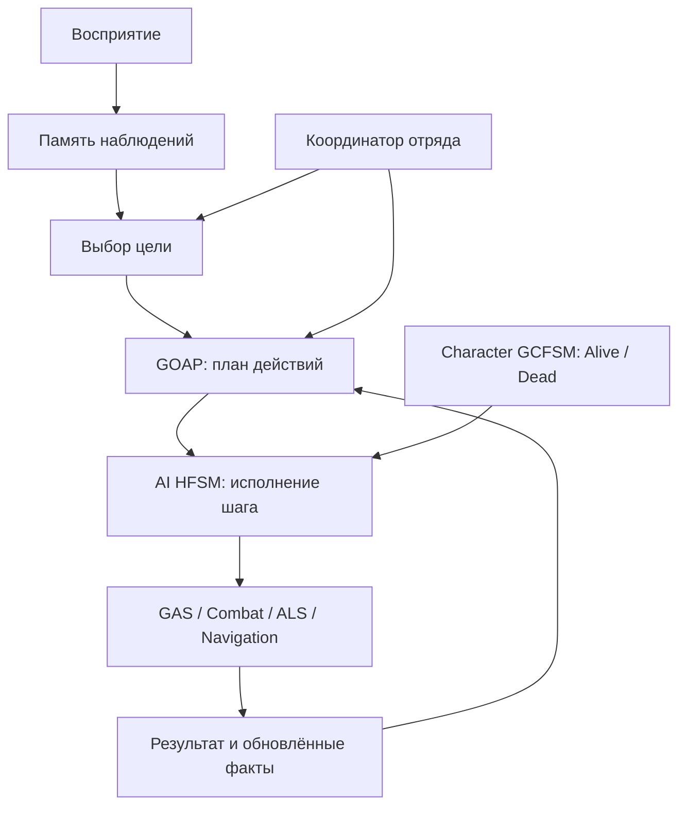

# Боты Nextgenone: спецификация AI

Дата: 2026-11-09. Ветка: `feature/nextgenone-bots`. Статус: архитектурные решения
согласованы в обсуждении; добавлен C++ первого пакета lifecycle/Move/Ability HFSM. Blueprint-граф и runtime ещё не проверены.
Ниже явно разделены существующая основа и требования к будущей реализации.

## 1. Принятые решения

1. Бот использует тот же `ANextgenoneCharacter`, `ANextgenonePlayerState`, ASC,
   инвентарь, Combat, Aim и ALS, что и игрок. Отличаются источник решений и настройки.
   Вторых bot-only способностей, ASC или боевой системы не создаём.
2. Для исполнения AI используем существующие **GCFSM / UHFSMState**. Действия — native-состояния с параметрами ExposeOnSpawn прямо на нодах; Blueprint-наследники для разных настроек не обязательны. UHFSMStateComponent остаётся доступен для независимых дополнительных механизмов, но отдельного action-компонента на каждое AI-состояние нет.
   Behavior Tree и StateTree не подключаем. Предыдущая рекомендация StateTree заменена
   этим решением: важны единый авторинг и зависимости; тактический планировщик нужен
   при любом исполнителе. Преимущество в производительности без замеров не заявляется.
3. **GOAP — целевая модель планирования**, отдельная от HFSM. Оценка полезности
   (Utility) может ранжировать цели и позиции, но не заменяет поиск цепочки действий.
   Первые пакеты действий отлаживаются на явно заданной последовательности без GOAP.
4. HFSM не содержит граф всех сочетаний угроз, патронов и дистанций. Она исполняет
   текущий шаг, обслуживает его lifecycle и сообщает результат планировщику.
5. Существующая GCFSM на Pawn сохраняет владение Alive/Dead и ресурсами GAS.
   Отдельная серверная AI HFSM на Controller управляет исполнением поведения;
   она не устанавливает собственные флаги жизни и не выдаёт базовые способности.
6. Планирование, восприятие, память и координация работают на сервере.
   Клиенты получают существующее игровое состояние и presentation.
7. Новые проектные AI-компоненты размещаем в `NEXTGENONE/Gameplay/AI`.
   Не переписываем ядро плагина GCFSM, не создаём отдельный универсальный AI-framework.

## 2. Что уже есть и чего пока нет

| Часть | Текущий статус |
| --- | --- |
| ALS demo AI | AALSAIController запускает Behaviour Tree; demo tasks выбирают случайную точку и игрока с индексом 0. Не являются основой тактического мышления |
| NGAIController | Наследник AAIController; bWantsPlayerState=true; фокус на Pawn через GetPawnViewLocation; автоматический запуск brain выключен |
| Доступ AI к GAS | GetReadyAbilitySystem(ExpectedPawn): сервер, ожидаемый управляемый Pawn, текущий Avatar и готовый Alive |
| Удержание способности | Общий ASC принимает AbilityInputTagPressed/Released при local control или authority; серверному AI не нужен LocalPlayer |
| Общие действия персонажа | Jump/Dash/Mantle/Punch/Aim/Fire/Reload и Combat существуют; интеграция их исполнения AI ещё не реализована |
| AI HFSM, Move/GAS-состояния | Реализован C++ первого пакета: controller lifecycle, WaitForGameplay, общий результат шага, Move и удерживаемая InstancedPerActor ability; параметры на нодах ExposeOnSpawn. Авторинг/сборка/runtime не проверены; сетап: Docs/Gameplay/BotSetup.md |
| Восприятие, память, выбор цели, GOAP | Не реализованы |
| Укрытия, роли отряда, обход | Не реализованы |
| Подтверждённый паритет в игре | Нет: C++-основа просмотрена статически, не собрана и не проверена в runtime |

`AIModule` — прямая public dependency NEXTGENONE, поскольку публичный NGAIController.h
наследуется от AAIController. Это модуль UE, необходимый независимо от выбора
GCFSM/StateTree; зависимость не означает использование Behavior Tree.
StateTree явно не включён в .uproject и не добавлен в Build.cs.
ALS plugin, Blueprint/assets и режимы спавна в текущем пакете не изменялись.

## 3. Выводы из FEAR и границы исследования

Изучен сторонний репозиторий [Fear-SDK-1.08](https://github.com/xfw5/Fear-SDK-1.08),
ревизия `2fc3557b0037d5fe01ac607b907d4b8511b9e4b2`.
Это зеркало исходников SDK; полнота движка, соответствие неизменённой версии игры
и условия прямого заимствования не установлены. Код FEAR в проект не переносился.
Перенимать архитектурные принципы; перед копированием кода проверить условия SDK.

| Наблюдение по исходникам | Решение для Nextgenone |
| --- | --- |
| AIGoalMgr выбирает актуальную цель, учитывает приоритет прерывания и необходимость перепланирования | Отделить выбор цели от исполнения; сохранять текущую цель при равной оценке, избегать постоянного переключения |
| AIPlanner строит план через A*, начиная поиск от цели | Планировщик ищет последовательность по предусловиям, эффектам и стоимости |
| AIActionAbstract отделяет плановые свойства от контекстных проверок и lifecycle | Описание действия отдельно от экземпляра исполнения; проверять реальные условия перед стартом |
| CAIPlan повторно проверяет условия очередного действия и валидность текущего | Изменение мира может обесценить план; нужен отказ и перепланирование |
| Плановые эффекты по умолчанию не изменяют реальный мир | Ожидаемая перезарядка не добавляет патроны: их изменяет существующая ability |
| AIWorkingMemory хранит наблюдения; Blackboard различает видимость от глаз и от оружия | Разделить память о цели, возможность видеть и возможность стрелять |
| AICoordinator управляет отрядами; групповая координация — отдельный слой | Индивидуальный GOAP дополняется ролями и резервациями, не обещает кооперацию автоматически |

Проверенные файлы в указанной ревизии:

- [AIGoalMgr.cpp](https://github.com/xfw5/Fear-SDK-1.08/blob/2fc3557b0037d5fe01ac607b907d4b8511b9e4b2/Game/ObjectDLL/AIGoalMgr.cpp)
- [AIPlanner.cpp — также содержит CAIPlan](https://github.com/xfw5/Fear-SDK-1.08/blob/2fc3557b0037d5fe01ac607b907d4b8511b9e4b2/Game/ObjectDLL/AIPlanner.cpp)
- [AIActionAbstract.h](https://github.com/xfw5/Fear-SDK-1.08/blob/2fc3557b0037d5fe01ac607b907d4b8511b9e4b2/Game/ObjectDLL/AIActionAbstract.h)
- [AIActionReload.cpp](https://github.com/xfw5/Fear-SDK-1.08/blob/2fc3557b0037d5fe01ac607b907d4b8511b9e4b2/Game/ObjectDLL/AIActionReload.cpp)
- [AIActionAttack.cpp](https://github.com/xfw5/Fear-SDK-1.08/blob/2fc3557b0037d5fe01ac607b907d4b8511b9e4b2/Game/ObjectDLL/AIActionAttack.cpp)
- [AIWorkingMemory.h](https://github.com/xfw5/Fear-SDK-1.08/blob/2fc3557b0037d5fe01ac607b907d4b8511b9e4b2/Game/ObjectDLL/AIWorkingMemory.h)
- [AIBlackBoard.h](https://github.com/xfw5/Fear-SDK-1.08/blob/2fc3557b0037d5fe01ac607b907d4b8511b9e4b2/Game/ObjectDLL/AIBlackBoard.h)
- [AICoordinator.h](https://github.com/xfw5/Fear-SDK-1.08/blob/2fc3557b0037d5fe01ac607b907d4b8511b9e4b2/Game/ObjectDLL/AICoordinator.h)

Доклад автора: Jeff Orkin, GDC 2006,
[Three States and a Plan](https://www.gamedevs.org/uploads/three-states-plan-ai-of-fear.pdf).
Описывает Goto / Animate / UseSmartObject и вынесенное планирование. Число состояний
не является требованием для нашего проекта. Поиск укрытий и конкретные алгоритмы
групповых манёвров пока не разобраны полностью; приведённые ниже решения проектные.

## 4. Поток решений и владельцы

| Владелец | Ответственность |
| --- | --- |
| AIController и его проектные компоненты | Server lifecycle AI, память, цель/план, AI HFSM, запросы движения и фокуса |
| AI HFSM, контекст Controller | Исполнение одного шага, ожидание результата, обработка отказа и прерывания |
| GOAP | Поиск последовательности; не двигает Pawn и не изменяет здоровье/боезапас |
| Координатор отряда | Роли, ограниченные резервации позиций, явный обмен информацией |
| ANextgenonePlayerState | Единственный ASC, здоровье, инвентарь и поколение Avatar |
| ANextgenoneCharacter | ALS, Combat, Aim, Character GCFSM, presentation |
| Character GCFSM / definitions | Alive/Dead, выдача/снятие state abilities/effects |
| GAS / Combat | CanActivate, cooldown/cost, экипировка, боезапас, темп, урон и эффекты |

## 5. Минимальные доработки HFSM

Новый контракт автоматических выходов — UGCFSMState::GetDeclaredTransitionEvents(), без зависимости GCFSM на NEXTGENONE. Move/Ability наследуют декларации Succeeded/Failed/Aborted от UNGAIActionState, Wait объявляет Ready. Имена отправляемых AI-событий общие в NGAIEvents.h, входные result-event параметры удалены. Редактор синхронизирует объявления при реконструкции ноды, сохраняет совпадающие связи и orphan-пины исчезнувших связанных выходов; внешние события остаются ручными. Эта доработка пока не собрана/не проверена в редакторе. Пользователь отдельно подтвердил работу предыдущей версии бота после добавления NavMesh; это не проверка новых выходов. Миграция описана в Docs/Gameplay/BotSetup.md.

Использовать существующие `void Enter/Exit` и наследников UHFSMState.
Каждое action-состояние проверяет свои данные и освобождает собственные частично полученные ресурсы. Общий rollback входа,
AbortEnter и OnEnterFailed не возвращать. Ошибка действия — результат AI,
а не новая семантика входа всех UI/Character состояний.

Первый граф: `WaitingForGameplay → Idle → ExecutingAction → Idle`;
потеря готовности останавливает исполнение, новый Avatar начинает новый цикл.
Результат Failed/Aborted передаётся исполнителю плана; граф может обрабатывать его
переходом, но не хранит условия всех тактических комбинаций.

Проектные native-состояния:

- UNGAIActionState: общая база, владеет текущим запуском и результатом.
- UNGAIMoveState: MoveTo/завершение пути/отмена собственного request.
- UNGAIAbilityState: запуск, press/release, наблюдение завершения, отмена собственного spec.
- UNGAIWaitForGameplayState: барьер готовности после старта/возврата графа в ожидание.
- Focus: пока не реализован; точка/цель и владение фокусом потребуют отдельного решения при добавлении.

Параметры действий задаются на нодах через ExposeOnSpawn до Enter. Параллельные движение,
фокус и ability допускаются только с определённым владельцем ресурса и явным условием
завершения шага. В начальном варианте один активный шаг плана; фоновые сенсоры работают отдельно.
В общие UHFSM-классы не добавлять обязательные AI-зависимости. Их размещение в UIModule
само по себе не требует переноса модуля в рамках этого пакета.

AI-граф размещается в bot Controller Blueprint, контекст разрешает AIController/Pawn,
не требует PlayerController/LocalPlayer, UI input и IMC. Character-граф остаётся на Pawn.
Запуск/остановку отдельной нереплицируемой GCFSM нужно реализовать через фактический API
плагина; смена Pawn должна завершать старое исполнение и освобождать его контекст.

## 6. Контракт действия и отмены

Описание для планирования: ID/тип действия, параметры цели/позиции, предусловия,
ожидаемые эффекты, неотрицательная стоимость и контекстные проверки.
Конфигурация хранится в definitions/assets; не зашивать Game-пути, дистанции и тайминги в логику.

Экземпляр исполнения хранит ExpectedPawn, ASC/AvatarGeneration, ID плана и запуска,
Move request ID, ability spec/instance, подписки, таймеры и резервации.
Результаты: `Running / Succeeded / Failed / Aborted`, с причиной отказа для диагностики.
Терминальный результат принимается один раз только для актуального запуска.
Успех запроса запуска не равен успеху действия; окончание ability с cancel — не успех.

Перед стартом повторно проверить цель, текущий Avatar, gameplay-ready и реальные
условия действия. GAS остаётся окончательным арбитром активации; GOAP не дублирует
полностью CanActivate и не гарантирует, что ability сможет запуститься.

Exit/abort снимает собственные подписки и таймеры, освобождает удержание,
отменяет собственные Move/GAS handles и резервации. Cleanup должен быть повторно
безопасным, учитывать синхронные callbacks и не затрагивать новое исполнение.
При смене Pawn нельзя отправлять release/cancel в ASC уже нового Avatar.
Потеря готовности не должна блокировать cleanup: ready-getter нужен для старта,
но освобождение адресуется сохранённым ресурсам с проверкой их идентичности.

Смерть, unpossess, смена Avatar и EndPlay принудительно завершают AI-действие.
При обычной смене тактической цели учитывается прерываемость действия;
запрет тактического прерывания не мешает смерти и уничтожению освободить ресурсы.
Поздние callbacks от предыдущего плана/шага/жизни игнорируются.

## 7. Паритет действий с игроком

Способности выдаёт активная Character definition или экипировка. Controller/HFSM
не выдают их повторно и не содержат упрощённые bot-only аналоги.
При одинаковых grants и настройках бот имеет те же возможности и ограничения.

| Действие | Исполнение и оставшаяся AI-работа |
| --- | --- |
| Движение, бег, стойка | Navigation + существующие ALS настройки; обработать unreachable, stuck и смену режима, без телепорта к цели |
| Jump | Общая Jump ability с press/release; AI выбирает место/время и проверяет результат перехода |
| Mantle | Общая Mantle ability и существующий ALS executor; подход, разворот, проверка препятствия и фактической конечной позиции |
| Dash | Общая Dash ability; текущая доступность только в воздухе сохраняется |
| ADS | Focus/ControlRotation + Aim ability; press один раз, release на завершении/отмене |
| Огонь | После rebase использовать общий GAS input основной атаки; Combat остаётся исполнителем выстрела. AI-интеграция, ограниченные очереди и проверка линии огня — пакет 2 |
| Reload | Общая Reload ability; дождаться завершения и реального изменения патронов. Интеграция — пакет 2 |
| Оружие | Общие GAS-действия активации item/экипировки, реальные предметы в инвентаре; подбор параметров AI — пакет 2 |
| Punch | Общая Punch ability; подход на дистанцию, ограничения оружия и состояния сохраняются |
| Взаимодействие | Существующий Interaction/GAS; отдельно проверить выбор цели AI. Player UI/storage RPC не считать автоматически пригодными для бота |
| Смерть | Существующие здоровье, Character GCFSM и Death ability; AI прекращает действия |

Для удерживаемых Jump/ADS `TryActivateAbilityByInputTag` не заменяет press.
Однократные способности можно запускать через общий ASC; завершение отслеживать
по нужному spec/instance. Не вызывать FireOnServer напрямую из AI и не наносить
урон из HFSM. При abort не отменять все чужие способности персонажа.

NavMesh не учит бота залезать автоматически. Для выбранного маршрута нужны переходы
типа Nav Link и исполнитель traversal через Jump/Mantle. Обычный path following
не должен одновременно тянуть Pawn во время GAS/ALS traversal; после завершения
маршрут возобновляется или пересчитывается. Для прыжка завершение input ability
не обязательно означает приземление; успех traversal проверяется отдельно.

Готовность Mantle зависит от BP_ALSMantleExecutor, анимаций и кривых на Pawn.
Спецификация не обещает произвольное лазание: используются существующие допустимые
препятствия и возможности ALS. Гранаты и новые типы укрытий требуют игровых механик.

## 8. Восприятие, память и выбор целей

Наблюдение содержит источник (зрение/слух/союзник), объект, last-known position,
время, достоверность и срок актуальности. Реальные данные Actor доступны серверу,
но AI принимает решения по своим наблюдениям; потеря зрения не обновляет позицию
сквозь стены. Обмен информацией с союзником явный, с сохранением происхождения.

Различать LOS от глаз, линию выстрела от оружия, достижимость позиции и опасность
для союзника. Запуск общей Fire ability не заменяет тактическую проверку линии огня.
Базовые цели: патруль/ожидание, расследование шума, поиск, атака, сохранение жизни.
Оценка актуальности и минимальная устойчивость выбора настраиваются; не менять
цель каждый кадр при близких оценках. Не обещать слух без игровых событий шума.

## 9. GOAP и перепланирование

Начальный ограниченный словарь фактов: есть актуальная цель, известна её позиция,
есть подходящая позиция, достигнута позиция, оружие экипировано, есть патроны
в магазине/резерве, есть линия огня. Источники фактов — память и реальные Gameplay-системы.
Не хранить в AI второй независимый счётчик здоровья или патронов.

Примеры действий: Equip, MoveToPosition, Aim, FireBurst, Reload, Investigate, Search.
Jump/Mantle могут быть деталями traversal; включать их отдельными GOAP-шагами только
если это влияет на тактические варианты. Например: экипировать → занять позицию →
перезарядиться при необходимости → прицелиться → выполнить ограниченную очередь.
FireBurst не объявляет противника гарантированно убитым; результат подтверждается миром.

Первый GOAP — ограниченный поиск A* от цели по предусловиям/эффектам и стоимости.
До реализации зафиксировать типы фактов, разрешение параметров, сравнение состояний,
проверку циклов и критерий завершения; не копировать структуру памяти LithTech.
Задать бюджет поиска и повторных попыток. Если плана нет — безопасное ожидание,
смена цели или поиск другой позиции, без бесконечного replanning каждый Tick.

Перепланировать при отказе шага, смене цели, существенном изменении угрозы,
недоступной позиции, смене оружия или потере роли/резервации. Изменения объединять;
не запускать полный поиск на каждый perceptual callback. Плановые эффекты действуют
только в поиске; здоровье, патроны и позиции подтверждаются исполнением в игре.

## 10. Отряд, позиции и бюджеты

Координатор назначает роли (удержание контакта, обход, поддержка) и резервирует
позиции с владельцем, ID и сроком действия. Роль ограничивает/взвешивает выбор цели,
но не управляет каждым выстрелом и не обходит GAS. При смерти, отказе пути или
устаревании роли резерв освобождается. Несколько ботов не занимают одну позицию
по независимым планам без согласования.

Поиск позиции учитывает путь, LOS, угрозу, укрытие, союзников и занятость.
EQS можно подключить при появлении этой задачи; это отдельное решение,
не обязательная зависимость текущего пакета. Подавление, гранаты и реплики
добавляются вместе с соответствующими механиками/контентом.

Perception, поиск пути/позиций и GOAP работают по событиям и с ограниченным бюджетом.
Масштаб группы и частоты задаются конфигурацией и уточняются замерами.
Нужна диагностика: текущая цель/оценка, план/шаг/ID, причины отказа/перепланирования,
возраст наблюдений и владелец резервации. Базовый вариант — логи и доступные средства
визуализации UE/GCFSM, без нового обязательного debug UI.

## 11. Сеть и Blueprint-контракт

AIController и AI HFSM исполняются только на сервере; план/память не реплицируются
как отдельный граф. Character GCFSM сохраняет текущую репликацию. Клиенты наблюдают
movement, equipment, Gameplay Effects/Cues и presentation. Mixed ASC replication
и owner-only инвентарь пока сохраняются; отображение бота на клиентах и late join
нужно проверить отдельно. Нет owning PlayerController бота — не предполагать
наличие LocalPlayer или доставку player-only client RPC.

После сборки пользователь создаёт bot-вариант настроенного Nextgenone Character:
сохраняет Character FSM и Alive/Dead definitions, назначает NGAIController (позднее
его BP с AI-графом), Auto Possess AI = Placed in World or Spawned, Auto Possess Player
отключён. GameMode должен создавать ANextgenonePlayerState. StarterItems настраиваются
на Combat; для Mantle сохраняется проектный executor с нужными ассетами.

Input/IMC не являются источником выдачи abilities. Однако текущий
NGCharacterStateResources валидирует input mappings до определения локального игрока:
на первом этапе сохранить рабочие definitions/InputConfig. Удаление input-зависимости
из валидации bot definitions — отдельная доработка, без дублирования GAS grants.
Авторинг BP/анимаций делает пользователь; агент реализует C++, GAS и серверные инварианты.
Новые BlueprintCallable/events добавлять только под конкретную потребность авторинга.

## 12. Пакеты реализации и критерии готовности

| Пакет | Результат | Критерий после разрешённой проверки |
| --- | --- | --- |
| 1. Lifecycle и исполнитель HFSM | Server AI-граф, общий результат шага, Move и удерживаемая ability | Idle → Move → Idle; press/release ADS; abort, повторный Enter, смерть и смена Pawn не оставляют ресурсов |
| 2. Паритет действий | Общие Equip/Fire/Reload/Punch/Jump/Dash/Mantle и traversal | Действия соблюдают ограничения игрока; завершение/отмена относятся к нужному запуску, путь корректно возобновляется |
| 3. Восприятие и память | Отношения команд, зрение/шум, last-known position, поиск | После потери контакта бот ищет по памяти, без слежения сквозь стены |
| 4. GOAP | Выбор цели, поиск плана, бюджеты и перепланирование | Разные начальные патроны/позиции дают допустимые планы; отказ пути и невозможный план обрабатываются без цикла |
| 5. Тактика группы | Оценка позиций, роли, резервации и обход | Один удерживает контакт, другой обходит; занятость и отказ манёвра обрабатываются согласованно |

Пакет 1 — следующий ограниченный этап, а не разрешение реализовать все пакеты сразу.
Базовые негативные сценарии: отказ CanActivate, недостижимая точка, отмена во время
reload/mantle, поздний callback старого шага, смерть/unpossess/respawn, смена оружия,
EndPlay и очистка резерваций. Сетевые сценарии: dedicated server с двумя клиентами,
late join, видимость ADS/выстрела/смерти, отсутствие доступа к чужому личному инвентарю.

Сборку выполняет пользователь: AGENTS.md — «сборку выполняет пользователь».
Тестовый этап требует отдельного разрешения: «Не начинать этап тестирования без
отдельного явного апрува пользователя на этот этап». Сейчас выполнен только
статический просмотр исходников/документации; UBT, PIE, автотесты и сеть не запускались.
