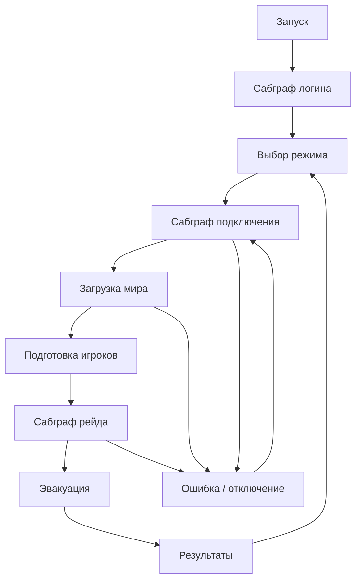

# Глобальная система сценариев игры

Дата: 2026-11-04.

Статус: зафиксированная концепция по обсуждению с пользователем. Реализация не начата. Конкретные API, классы и возможности GCFSM требуют проверки по исходникам проекта. Этот документ не подтверждает поддержку перечисленных возможностей плагином.

## Идея

Нужен сценарный слой, в котором можно визуально увидеть последовательность работы игры: запуск, логин, подключение, загрузку режима, подготовку игроков, рейд, задания, эвакуацию и результаты. Граф состоит из состояний и сабграфов; состояния набираются переиспользуемыми компонентами действий и наблюдателей.

Глобальный граф координирует отдельные системы, но не переносит их внутреннюю логику в себя. Character FSM и UI FSM сохраняются. Сценарий может запустить их, запросить переход и дождаться результата через явный контракт. GAS остаётся владельцем способностей и эффектов; инвентарь — предметов и контейнеров; система соединения — сетевого подключения.

Цель — единый способ авторинга сценариев и понятная навигация по flow, а не один объект, выполняющий всю работу игры.

## Пример структуры

Это схема пользовательского flow. Она не означает, что все узлы исполняются одним экземпляром машины или на одном компьютере. Наличие ветки реконнекта не означает реализации восстановления игровой сессии.

Главный граф показывает крупные этапы. Логин, подключение, режим и отдельные задания могут быть сабграфами. Независимые параллельные квесты используют отдельные экземпляры графов с общим механизмом исполнения, чтобы не увеличивать основной граф каждой задачей.

## Владение и место исполнения

| Область | Владелец исполнения | Ответственность |
|---|---|---|
| Клиентский flow приложения | GameInstance / GameInstanceSubsystem | Логин, выбор режима, подключение, переход между мирами, восстановление клиентского flow |
| Локальный игрок | Явный контекст LocalPlayer | Готовность своего игрока, запросы и представление для его Controller/HUD; без first-player fallback |
| Серверный сценарий режима | Серверный контекст режима | Правила рейда, общие условия, разрешение начала/завершения, эвакуация |
| Персональные задания | Серверный контекст конкретного игрока | Авторитетный прогресс и результат задания |
| Состояния персонажа | Существующая Character FSM на Pawn | Alive/Dead и ресурсы состояний персонажа |
| Экраны и UI-ввод | Существующая UI FSM | Монтаж/демонтаж окон, переходы, layout и input policy |

Клиентский GameInstance переживает смену мира; серверный GameInstance также локален своему процессу и не является общей реплицируемой сущностью. Реплицируемое состояние режима должно иметь сетевого Actor-владельца. Конкретное размещение серверного executor и сетевого моста выбирается после проверки GCFSM и lifecycle GameMode/GameState. Новые базовые GameMode/GameState ради документа не вводятся.

Смена GameMode выполняется существующим серверным механизмом запуска/перехода к карте с нужным режимом. Клиентский граф не может произвольно заменить GameMode работающего удалённого сервера.

## Состав сценария

### Граф и состояние

Граф определяет этапы, условия и переходы. Состояние описывает, какие действия и наблюдатели действуют в течение этого этапа. Общий HFSM lifecycle сохраняется: void Enter/Exit, без возвращения глобального rollback-механизма. Ошибки и частичная очистка обрабатываются компонентом; ожидаемый результат передаётся событием сценария.

### Компоненты действий

Действие обращается к существующей системе: запросить подключение, начать загрузку, подключить UI flow, запустить синематику, активировать предусмотренную способность или отправить событие дочерней FSM. Действие не создаёт второе состояние здоровья, инвентаря или соединения.

Для долгой операции определены завершение, отказ и отмена. Выход из состояния снимает принадлежавшие ему запросы/ресурсы там, где операция допускает отмену. Если отмена невозможна, запоздалый результат не должен переводить уже неактивный сценарий.

### Компоненты-наблюдатели

Наблюдатель отслеживает конкретное условие: готовность контекста игрока, состояние Character FSM, завершение загрузки, прогресс цели или потерю соединения. Он подписывается при входе и снимает подписки при выходе.

Контракт источника включает текущее состояние и событие изменения. При подключении наблюдатель подписывается и проверяет текущий снимок, чтобы не пропустить уже выполненное условие. Повторные уведомления не должны повторно выполнять переход или действие. Tick/таймеры не используются как замена отсутствующему lifecycle-событию; исключения требуют конкретного обоснования.

### Контекст исполнения

Контекст предоставляет актуальные мир, локального игрока или серверного участника, Controller, PlayerState, Pawn и необходимые сервисы. Не каждая операция требует всех этих объектов: подключение возможно до появления Pawn, а экран смерти может работать после UnPossess.

Один слой разрешает и обновляет зависимости. Виджеты получают готовые источники данных от UI-адаптера/маунтера и подписываются только на изменение содержимого. Каждый виджет не реализует собственное ожидание PlayerState, GAS или реконнекта.

Конкретная форма контекста — объект, структура или существующий API — пока не утверждается. Не создавать универсальный service locator без подтверждённой потребности.

## Связь с Character FSM и UI FSM

Character FSM остаётся источником состояния жизни. Готовность её ресурсов может быть одним из условий сценария подготовки игрока, но не является готовностью всей сессии. Connecting, логин, загрузка и реконнект существуют независимо от Character FSM.

Глобальный сценарий задаёт крупный этап, UI FSM определяет отображение и локальные переходы окон. Открытие инвентаря не переводит весь сценарий рейда в новый глобальный этап. Смерть персонажа не обязана завершать серверный рейд: сценарий режима определяет, что делать с этим событием.

HUD не владеет долгоживущим flow. После пересоздания он подключается к активному клиентскому сценарию, читает актуальное состояние и восстанавливает требуемое представление. Виджеты предыдущего мира не сохраняются в GameInstance.

Асинхронная Blueprint-нода ожидания может позже стать удобной оболочкой над наблюдателем. Она не должна создавать второй механизм готовности или заменять обработку смерти, respawn и смены мира.

## Сервер и клиенты

Единая система авторинга не означает синхронного исполнения одного графа на всех машинах. У сервера и клиентов свои экземпляры и допустимые действия. Для сетевых сценариев предусмотрен явный мост:

- сервер публикует нужное клиентам состояние/этап;
- клиент получает команды представления и отправляет только предусмотренные запросы/подтверждения;
- сервер проверяет отправителя, актуальность участника/этапа и условия перехода;
- повторные или запоздалые сообщения не выполняют действие второй раз.

Пример: сервер входит в подготовку рейда; клиенты загружают мир и подтверждают готовность; сервер проверяет участников и собственные условия, затем разрешает старт. Клиентское подтверждение не заменяет серверную готовность и не является правом самостоятельно изменить общий этап.

Реплицируются только необходимые данные сценария, а не все внутренние подписки и runtime-объекты графа. Новому клиенту нужен актуальный снимок, а не только события, отправленные до его подключения. Подтверждение, timeout, отказ и политика переподключения задаются сценарием, без универсальной бесконечной попытки.

## Смена мира, смерть и реконнект

1. Долгоживущий клиентский flow сохраняет этап и параметры операции, которые действительно нужны после travel.
2. При завершении мира освобождаются ссылки и подписки на его Actor/Controller/Pawn/HUD.
3. Новый мир получает новый актуальный контекст; старые callback и сетевые ответы отбрасываются по идентичности экземпляра операции, мира, Pawn или серверного этапа — в зависимости от действия.
4. Respawn переподключает контекст к новой жизни, не переиспользует ресурсы старого Pawn.
5. При отключении UI показывает соответствующий этап. Повторное подключение и восстановление серверного прогресса — отдельные операции, не побочный эффект показа экрана.

Конкретные идентификаторы операций и переходов определяются при реализации; не полагаться только на bool готовности, который остаётся от предыдущей жизни или соединения.

## Инвентарь и исходная проблема Action-панели

В текущем NGInventoryPanel источник Inventory разрешается однократно в NativeConstruct; PawnChanged обновляет только Combat. Раннее создание панели до PlayerState может оставить её без подписки на инвентарь. Это выявленный дефект lifecycle, а фактический порядок событий конкретного запуска не записан в логах.

Сценарный слой должен централизовать подготовку контекста и передачу источника UI. Он не должен маскировать дефект случайной задержкой. Даже после правильного входа в Gameplay источники переподключаются при смене мира/Pawn, а содержимое инвентаря обновляется существующими репликационными событиями.

Готовность пустого контейнера не определяется количеством предметов. Когда появится backend, завершение серверной загрузки станет явным условием сценария. Если конкретный экран требует полного начального snapshot, нужно дождаться и подтверждения загрузки, и разрешения необходимых реплицируемых ссылок; одного bool недостаточно. Для обычной панели допускается показать пустые ячейки и затем обновить содержимое.

## Границы модулей

GCFSM рассматривается как существующий кандидат исполнения и Blueprint-авторинга. До проверки не вводятся собственный альтернативный движок графов или новые framework dependencies.

GameplayFoundation продолжает хранить общие игровые данные и механизмы без зависимостей на NEXTGENONE/ALS/UI/GCFSM. UIModule сохраняет общие HFSM-компоненты и UI. Начальная проектная склейка сценариев размещается в NEXTGENONE. Отдельный Scenario-модуль имеет смысл только после появления устойчивого общего ядра и доказанной необходимости; сейчас его создание не согласовано.

## Первый ограниченный этап

До реализации проверить по исходникам GCFSM:

- авторинг и запуск нереплицируемого графа с GameInstance/UObject-контекстом, доступ к World и lifecycle остановки;
- сабграфы, параллельные экземпляры и взаимодействие с существующими UHFSMState/StateComponent;
- требования Actor-контекста для сетевого исполнения и восстановления активного состояния;
- порядок запуска и подключения наблюдателей, очистку при travel/выходе;
- возможности, которые уже есть в плагине и не требуют проектного дублирования.

Затем реализовать один вертикальный путь: подключение/ожидание контекста → готовый живой игрок → игровой UI; смерть → Death UI; новый Pawn → повторная подготовка. Включить восстановление отображения после пересоздания HUD и обработку потери соединения. Это проверяет контракт, но не включает полноценный логин/backend, реконнект с восстановлением рейда, редактор квестов или библиотеку универсальных наблюдателей.

Авторинг графов и оформление UI выполняет пользователь; агент отвечает за C++ lifecycle, контракты и серверные проверки. Сборка запускается только по отдельному запросу пользователя, игровой/сетевой тестовый этап — только после отдельного апрува.

## Критерии первого этапа

- UI не ищет PlayerState/GAS независимо в каждом виджете.
- Позднее появление зависимостей и подписка после готовности дают одинаковый результат.
- Старый Pawn/мир/запрос не переводит новый сценарий.
- Пересоздание HUD восстанавливает активное представление без перезапуска клиентского flow.
- Потеря соединения имеет приоритет над состояниями персонажа; смерть корректно обрабатывается при раннем UnPossess.
- Серверные этапы нельзя переключить клиентским локальным событием.
- Существующие Character FSM, UI FSM, GAS и единственный инвентарь сохраняют своих владельцев состояния.

Документ фиксирует направление. Перечисленные критерии пока не реализованы и не проверены.
